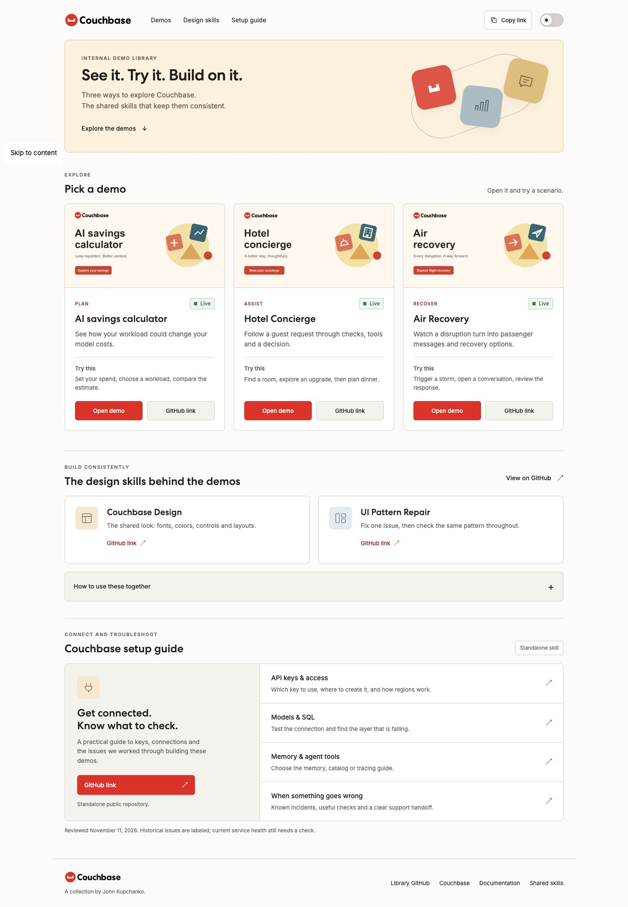
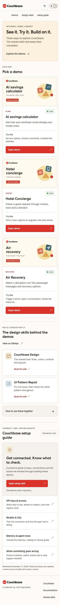

# Couchbase Internal Demo Library

I put this together so the team can open our demos, try a scenario, and find the skills we use to build them.

[Open the library](https://couchbase-demo-library.vercel.app/) · [Share feedback](https://github.com/john-couchbase/couchbase-demo-library/discussions)



## Start here

- Pick a demo and click **Open demo**.
- Use the short “Try this” prompt on its card to get started.
- Open **Design skills** for our shared UI rules, or **Setup guide** for Couchbase connections and troubleshooting.
- Use **Copy link** to share the library. The switch in the corner changes light and dark mode.

## The demos

| Demo | What to try |
| --- | --- |
| [AI Savings Calculator](https://couchbase-ai-savings.vercel.app/) | Enter your spend, choose a workload, and compare the estimated savings. |
| [Hotel Concierge](https://couchbase-hotel-concierge.vercel.app/) | Find a room, explore an upgrade, or plan dinner. Follow the checks and decision alongside the conversation. |
| [Air Recovery](https://couchbase-air-simulation.vercel.app/) | Trigger a storm, open a passenger conversation, and review the recovery response. |

Each demo opens separately. This repository contains the library website and its images; the demos have their own code and services. “Live” labels published links, not a continuous backend health check.

## The skills

- [Couchbase Design](https://github.com/john-couchbase/agent-skills/tree/main/couchbase-design) covers fonts, colors, controls, and layouts.
- [UI Pattern Repair](https://github.com/john-couchbase/agent-skills/tree/main/ui-pattern-repair) helps fix a UI issue across matching components and screen sizes.
- [Couchbase AIDP Setup](https://github.com/john-couchbase/couchbase-aidp-setup) covers API keys, models, SQL functions, memory, catalog, tracing, and troubleshooting. It stays in its own repository.

Use the two design skills together when changing an interface. Use the setup skill when connecting or troubleshooting the backend.

## Review and discussion

[Start a discussion](https://github.com/john-couchbase/couchbase-demo-library/discussions) for ideas or questions. [Open an issue](https://github.com/john-couchbase/couchbase-demo-library/issues) for a broken link or layout problem.

Useful feedback includes:

- Which demo or section you opened.
- What you expected and what happened.
- A screenshot and whether you used a phone, tablet, or computer.

<details>
<summary>Phone preview</summary>



</details>

## Run locally

No build step or API keys are needed for the library.

```sh
python3 -m http.server 5192 --directory dist
```

Open [localhost:5192](http://localhost:5192).

- `dist/index.html`: demo cards, links, and sharing metadata.
- `dist/style.css`: layout, typography, and themes.
- `dist/app.js`: theme switch and copy buttons.
- `dist/assets/`: logos, fonts, and social preview images.

## Publish an update

Vercel serves the contents of `dist/` through the existing `couchbase-demo-library` project. Publish that folder as the site root, then check the production link. GitHub pushes do not automatically deploy unless the project is connected to this repository.

Before sharing, check the links, phone layout, both themes, and preview images. Keep credentials and local Vercel settings out of GitHub.

Writing reviewed with the [Humanizer skill](https://github.com/blader/humanizer/blob/main/SKILL.md).
